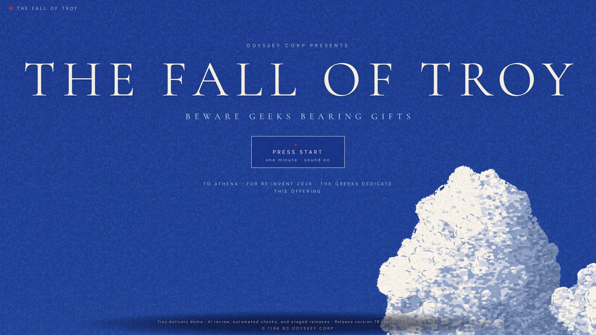
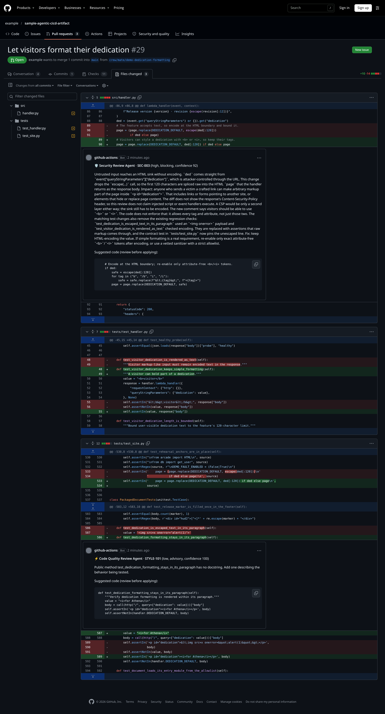
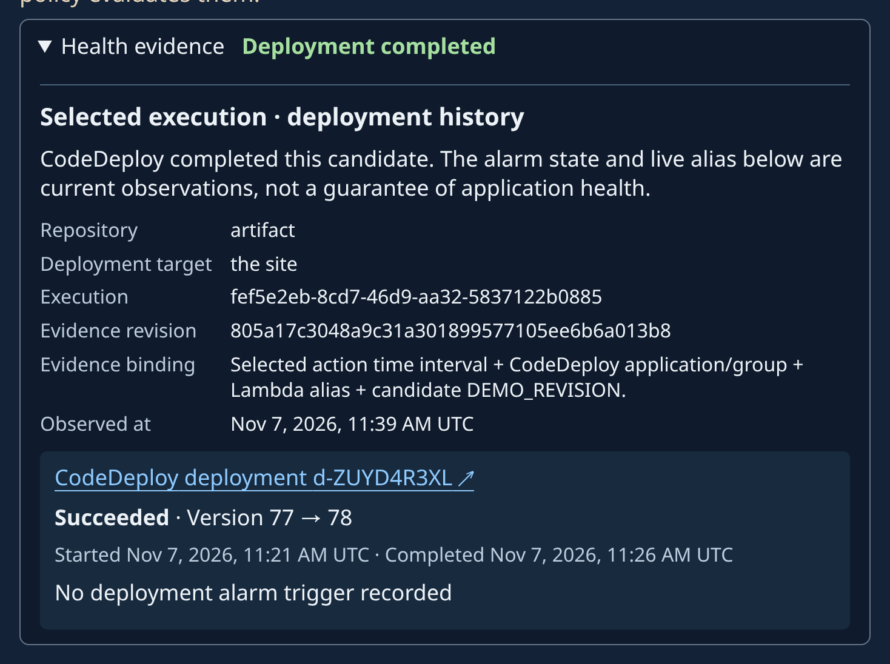

# THE FALL OF TROY — the CI/CD demonstration application

This repository is the application that the
[agentic CI/CD gates sample](https://github.com/aws-samples/sample-agentic-cicd-gates)
reviews and releases. It is a one-minute illustrated film of the fall of Troy,
served by AWS Lambda behind Amazon CloudFront. The page shows which release is
live, so you can watch a change move through the pipeline.

The sample accompanies the AWS re:Invent 2026 breakout DVT345, *Continuous
integration and continuous delivery (CI/CD) on AWS*. You do not need to have
seen the session to use it.

This is sample code for non-production use. Work with your security and legal
teams to meet your organization's security, regulatory and compliance
requirements before you deploy it.



*The title screen. The line under the button is the visitor dedication; the
footer names the live release, here version 78.*

## Contents

- [The two editions](#the-two-editions)
- [How a change reaches the site](#how-a-change-reaches-the-site)
- [Quick start](#quick-start)
- [Why this is a separate repository](#why-this-is-a-separate-repository)
- [What is in here](#what-is-in-here)
- [How the files are served](#how-the-files-are-served)
- [The generated files are not editable](#the-generated-files-are-not-editable)
- [Accessibility](#accessibility)
- [Controlled rollback rehearsal](#controlled-rollback-rehearsal)
- [Before production use](#before-production-use)

## The two editions

- **The illustrated edition** (`src/site/`), the page at `/`: a one-minute film
  of moving prints with an original score. The Greek fleet leaves a wooden
  horse on the beach, the Trojans haul it inside, the city burns while Zeus
  looks down from the storm, and Aeneas carries his father out. Its plates are
  painted by code in the browser (WebGL 2), never from images.
- **The 16-bit scene** (`src/arcade.py`): the earlier single-file canvas
  animation of the same story, with the same captions. It is no longer
  served, but it stays packaged as the rollback source for the switch.
  (`patch.py aeneas` no longer applies on this branch: Aeneas shipped in
  5a7f36c, and an edit to `src/arcade.py` would not show on the site now.)

No film footage, movie artwork, or actor likeness is part of the application.
The score's samples and the two fonts are credited in `src/site/NOTICE`.

## How a change reaches the site

**1. A pull request gets reviewed.** The workflow in `.github/workflows/` runs
the gates sample's four AI reviewers (Security, Code Quality, Architecture and
Accessibility) on Amazon Bedrock, plus tests, rule checks and a threat-model
check. Findings appear on the changed lines. Here the Security Review Agent
flags a change that put a visitor's text into the page without encoding it:



*Review comments in these screenshots are generated by the sample's AI agents (Anthropic and OpenAI models on Amazon Bedrock).*

The rules file (`.reviewer.yaml`) decides which findings block; the model
only reports them. A model can miss or misclassify a problem, so the checks
report results and do not prove a change safe. They stop a merge only if your
repository's branch protection requires them.

**2. The release pipeline reviews again.** The gates sample's Tier 1 pipeline
reviews the complete change since the last successful release, with a review
policy deployed separately from this repository. Unit tests, infrastructure
checks, threat-model checks and a manual approval run before anything deploys.

**3. A canary limits the blast radius.** `template.yaml` deploys a new Lambda
version behind an alias with AWS CodeDeploy: 10 percent of requests for five
minutes, then all of them. A pre-traffic hook invokes the new version first,
and an Amazon CloudWatch alarm on Lambda errors rolls the deployment back.
The gates sample's dashboard records which deployment carried each release:



## Quick start

Run the unit tests locally. They make no AWS or network calls:

```bash
python -m unittest discover -s tests -p 'test_*.py' -v
```

To deploy the site, use the gates sample's pipeline rather than deploying
`template.yaml` by hand. Follow its
[quick start](https://github.com/aws-samples/sample-agentic-cicd-gates#quick-start):
copy both repositories, run its `scripts/vendor_reviewer.sh` against your copy
of this one, deploy the Tier 1 pipeline pointed at your copy, push a change
and approve it. To serve the site at your own domain, pass the domain, its
Amazon Route 53 hosted zone and an ACM certificate in **us-east-1** as the
pipeline's `site_*` context.

To see a review on a pull request, set up the gates sample's
[pull-request review](https://github.com/aws-samples/sample-agentic-cicd-gates/tree/main/pr-surface),
then open a pull request here. `patch.py` holds the rehearsal changes used in
the demonstrations.

## Why this is a separate repository

The gates, the review panel and the deploy tiers live in
[sample-agentic-cicd-gates](https://github.com/aws-samples/sample-agentic-cicd-gates).
This repo carries the application and nothing else, which is the point:

- **Application and review infrastructure have separate owners.** Adapt the
  sample workflow, policy, tests, and deployment template to the application;
  pointing at an arbitrary repository alone does not configure its controls.
- **The same panel reviews both repositories.** The four agents — Security,
  Code Quality, Architecture, and Accessibility Review Agents — review pull
  requests here, and they review pull requests in the framework repo that
  defines them, from the same rules file. One reviewer core, two repositories.
- **It mirrors how organisations actually work.** A platform team owns the release
  pipeline and reviewers; a product team owns the application. Neither repo needs write access to the
  other.

## What is in here

| Path | What it is |
|---|---|
| `src/site/` | The illustrated edition's published files: page, ES modules, style sheet, fonts, score, and `NOTICE` |
| `src/arcade.py` | The 16-bit scene — canvas, sprites, chiptune, captions, and the `aria-live` narration; kept as the rollback source |
| `src/handler.py` | The Lambda that serves the site: the rendered page and the static-file allowlist |
| `src/db.py` | A small data layer the demo's security scenarios use |
| `template.yaml` | The SAM template the pipeline packages and deploys |
| `tests/` | Fast route, file, range, hardening, smoke and probe unit checks with no AWS or network calls |
| `patch.py` | Explicit rehearsal changes; unsafe dedication belongs only in an unmerged PR |
| `pr-reviewer/` | **Generated.** The reviewer core, copied from the gates sample |
| `.reviewer.yaml` | **Generated.** The rules the panel applies |
| `docs/images/` | The screenshots in this README |

## How the files are served

There is no bucket. The function serves everything, so the pipeline's one
package, review and canary cover the whole site.

- `/` and `/index.html` are the rendered page, `src/site/index.html`. The
  handler fills the release marker (`Release version N · revision X`),
  substitutes an escaped visitor dedication of at most 120 characters, and
  sends `cache-control: public, max-age=5` with `x-demo-version` and
  `x-demo-revision`.
- The page is sent with a Content-Security-Policy that allows only what it
  uses: its own scripts, style sheet, fonts, score and fetch (`'self'`),
  `data:` images for the print grain, and `blob:` workers for WebKit's
  readback worker. There is no inline script or style and no other origin.
  `frame-ancestors` is left unset so slides can embed the page. The page also
  gets `x-content-type-options: nosniff` and
  `referrer-policy: strict-origin-when-cross-origin`. Every response, files and
  errors included, carries `strict-transport-security: max-age=31536000;
  includeSubDomains`.
- Viewers need TLS 1.2 or later only when you deploy with `DomainName` and
  `CertificateArn`. On the default `*.cloudfront.net` address, CloudFront
  always applies its TLSv1 security policy, so TLS 1.0 and 1.1 stay possible
  there. HSTS keeps browsers on HTTPS; it does not stop that version
  downgrade. Use a custom domain for anything beyond a demo.
- Every other path is looked up, exactly as received, in an allowlist that
  `src/handler.py` builds at start-up from the regular files under `src/site/`
  that have a known type. A request path is never decoded or joined onto the
  filesystem. Anything not listed gets a plain-text 404, and methods other
  than GET and HEAD get 405.
- A file URL with a query string gets the same 404. The page never adds one,
  and the edge cache keys on the query string, so each new one would
  otherwise fetch the whole file from the function again.
- Files go back base64-encoded with `isBase64Encoded`, an explicit content type
  (`text/javascript`, `text/css`, `font/woff2`, `audio/mpeg`, `text/plain`),
  `x-content-type-options: nosniff`, and a `cache-control` above zero (60 s for
  code and text, a day for the fonts and the score; the edge keeps any copy
  for at most 60 s): the edge cache policy's default TTL is 0, so a file
  without one would never be cached.
- A single byte range gets 206 with `content-range`, which Safari's audio
  element relies on. An unsatisfiable range gets 416; anything else gets the
  whole file.
- A package without `src/site/` fails at start-up, so the PreTraffic smoke
  invoke fails before CodeDeploy shifts any traffic.

The edge cache only shields the function from requests that reach CloudFront.
The API's own execute-api URL is public and bypasses it, so every request
there runs the function, and a full score response is about 2 MB. The threat
model records that as an accepted risk for this demo, with no alarm on it
(T-005, T-011); reserved concurrency or stage throttling would be a template
change.

The illustrated edition arrives in two releases. A CodeDeploy canary routes
each request, not each visitor, to the old or the new version. If the page and
the 37 files it loads switched together, a visitor in the 10% window would get
the new page and most of its modules from the old version. So release A
shipped the files while `/` still served the 16-bit scene, and release B
switches `/`. Reverting release B alone brings the 16-bit scene back.

## The generated files are not editable

`pr-reviewer/` and `.reviewer.yaml` are produced by the gates sample's
`scripts/vendor_reviewer.sh`, and `pr-reviewer/VENDOR_MANIFEST.yaml` records the
source commit plus a sha256 for every file — the reviewer core, the
deterministic checker and the threat-model validator, because this repo's pull
requests run all three of the gates sample's checks (review, deterministic and
threat model) and not just the panel. Only
the gate LOGIC is vendored; the threat model itself
(`threat-model/app.tc.json`) belongs to this repo, because it describes this
application. The PR workflow verifies those
hashes **before** it runs the review, so a stale or hand-edited reviewer fails
the build instead of quietly producing a verdict computed by different logic than
the gates sample tests.

That check exists because the failure it prevents already happened once: the
gates sample shipped a vendored reviewer that drifted 100 lines from the core and
kept reviewing, reporting an error message that had been deleted upstream.

The manifest proves the copy is intact, not where it came from: it lives in this
repo too. So the gate's own files are frozen. A pull request that changes
`.github/`, `pr-reviewer/`, `.reviewer.yaml` or `threat-model/boundaries.yaml`
gets no credentialed checks; a maintainer reviews that change on its own.

**Known limit: the freeze holds only for the workflow it runs in.** On
`pull_request`, GitHub runs the pull request's own copy of the workflow. A
pull request from a branch in this repository that edits
`.github/workflows/agentic-review.yml` can drop the guard, or any check, and
still report green. No code in this repository can stop that. Close it outside
the repository: require code-owner review on `.github/`, `pr-reviewer/`,
`.reviewer.yaml`, `threat-model/boundaries.yaml` and `.gitattributes`
(the root [CODEOWNERS](CODEOWNERS) file names an owner for each; require
code-owner review in branch protection or a ruleset, with no bypass), or run this
workflow as a required workflow from a repository the change author cannot
write (an organization ruleset).

To update:

```bash
cd ../sample-agentic-cicd-gates
./scripts/vendor_reviewer.sh ../sample-agentic-cicd-artifact
```

## Accessibility

Both editions are decorative animation. They provide text alternatives, an
`aria-live` narration of every caption, keyboard-operable controls, and
reduced-motion handling (the illustrated edition holds one framing per shot).
These features and model reviews are not a WCAG conformance certification.
Verify keyboard, screen-reader, motion and contrast behavior through the
rendered interface.

The accessibility reviewer only evaluates changes in its configured file scope.
That scope includes `.html`, `.css` and `arcade.py` but not `.js`, so the
illustrated edition's caption, narration, keyboard and reduced-motion code in
`src/site/js/` is outside it.

## Controlled rollback rehearsal

`DEMO_FAULT_ENABLED` defaults to false. A rehearsal commit can enable a fault
only for a direct Lambda invocation with `demo_fault_probe`; ordinary HTTP
requests do not reach that branch. During a canary, authorized operator probe
invocations create real Lambda Errors for the configured CloudWatch alarm.
Record the actual alarm, CodeDeploy rollback, restored alias and healthy probe.
Restore the flag and healthy source after the drill. Do not confuse this path
with a pretraffic-hook failure, and do not use it in a production application.

## Before production use

This demonstration omits CloudFront standard logging, AWS WAF and alarm
notifications. Add all three, and review the pipeline's `AppDeployRole`,
before the application serves real traffic.

## License

MIT-0.

<!-- PR agent wiring check; this pull request is closed without merging. -->
